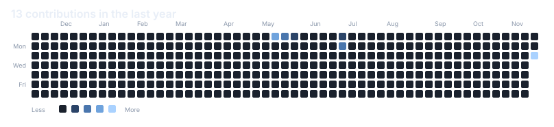
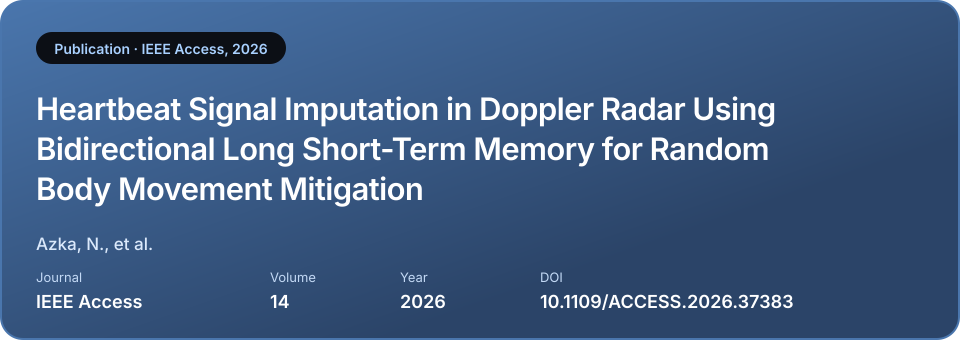
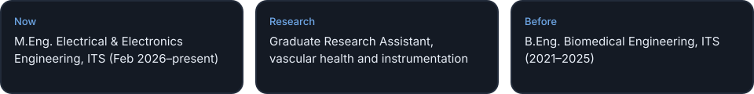
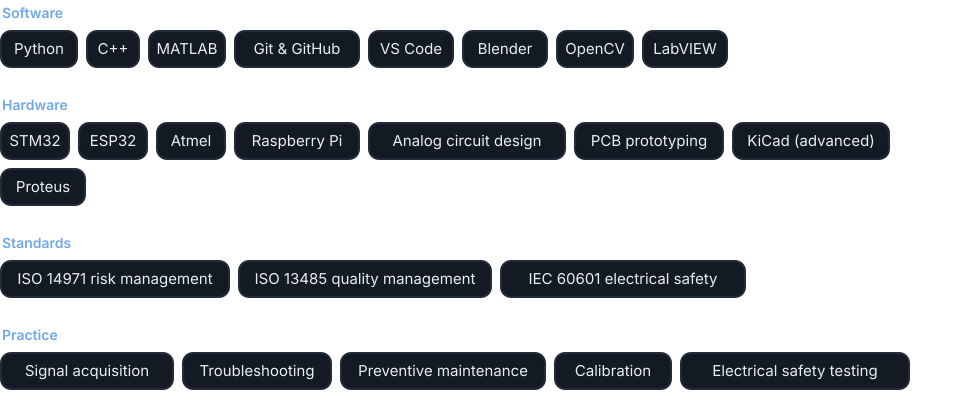

<!--
  Nadiya Azka profile README.
  Mirrors the HTML profile. GitHub cannot run CSS/JS, so visuals are themed SVGs in /assets
  (dark + light via <picture>) and interaction uses native 
.
  Edit build_assets.py, then run: python3 build_assets.py
-->

<picture><source media="(prefers-color-scheme: dark)" srcset="assets/header-dark.svg"><source media="(prefers-color-scheme: light)" srcset="assets/header-light.svg"></picture>

 

<picture><source media="(prefers-color-scheme: dark)" srcset="assets/h-contributions-dark.svg"><source media="(prefers-color-scheme: light)" srcset="assets/h-contributions-light.svg"></picture>
<a href="https://github.com/Azka79"><picture><source media="(prefers-color-scheme: dark)" srcset="assets/contributions-dark.svg"><source media="(prefers-color-scheme: light)" srcset="assets/contributions-light.svg"></picture></a>

 

<picture><source media="(prefers-color-scheme: dark)" srcset="assets/h-highlights-dark.svg"><source media="(prefers-color-scheme: light)" srcset="assets/h-highlights-light.svg"></picture>
<picture><source media="(prefers-color-scheme: dark)" srcset="assets/publication-dark.svg"><source media="(prefers-color-scheme: light)" srcset="assets/publication-light.svg"></picture>
 
<a href="https://doi.org/10.1109/ACCESS.2026.37383"><picture><source media="(prefers-color-scheme: dark)" srcset="assets/btn-doi-dark.svg"><source media="(prefers-color-scheme: light)" srcset="assets/btn-doi-light.svg"></picture></a>

 

<picture><source media="(prefers-color-scheme: dark)" srcset="assets/h-about-dark.svg"><source media="(prefers-color-scheme: light)" srcset="assets/h-about-light.svg"></picture>

I'm an Electrical Engineering master's student at Institut Teknologi Sepuluh Nopember (ITS), specializing in Medical Electronics and Embedded Instrumentation, with a bachelor's in Biomedical Engineering from ITS.

I like the whole engineering loop: designing circuits, prototyping hardware, acquiring physiological signals, processing them, then testing and validating the result.

Interested in biomedical R&D, medical electronics, research collaboration and healthcare technology.

<picture><source media="(prefers-color-scheme: dark)" srcset="assets/facts-dark.svg"><source media="(prefers-color-scheme: light)" srcset="assets/facts-light.svg"></picture>

 

<picture><source media="(prefers-color-scheme: dark)" srcset="assets/h-skills-dark.svg"><source media="(prefers-color-scheme: light)" srcset="assets/h-skills-light.svg"></picture>
<picture><source media="(prefers-color-scheme: dark)" srcset="assets/skills-dark.svg"><source media="(prefers-color-scheme: light)" srcset="assets/skills-light.svg"></picture>

 

<picture><source media="(prefers-color-scheme: dark)" srcset="assets/footer-dark.svg"><source media="(prefers-color-scheme: light)" srcset="assets/footer-light.svg"></picture>
<a href="https://linkedin.com/in/nadiyaazkaa"><picture><source media="(prefers-color-scheme: dark)" srcset="assets/btn-linkedin-dark.svg"><source media="(prefers-color-scheme: light)" srcset="assets/btn-linkedin-light.svg"></picture></a>
&nbsp;
<a href="https://github.com/Azka79"><picture><source media="(prefers-color-scheme: dark)" srcset="assets/btn-github-dark.svg"><source media="(prefers-color-scheme: light)" srcset="assets/btn-github-light.svg"></picture></a>

